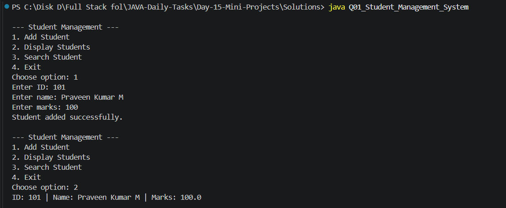
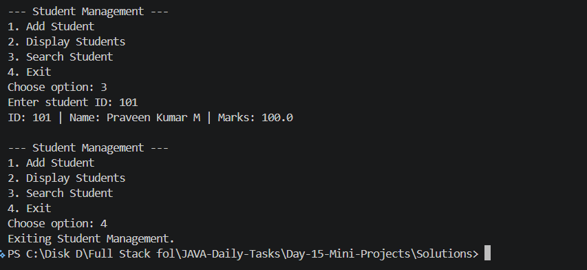
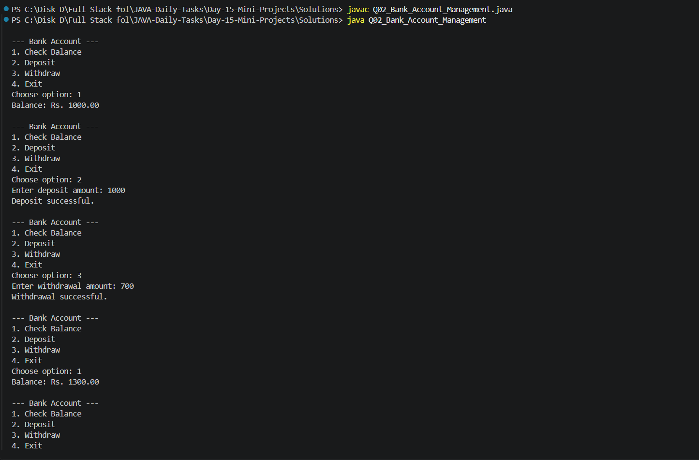
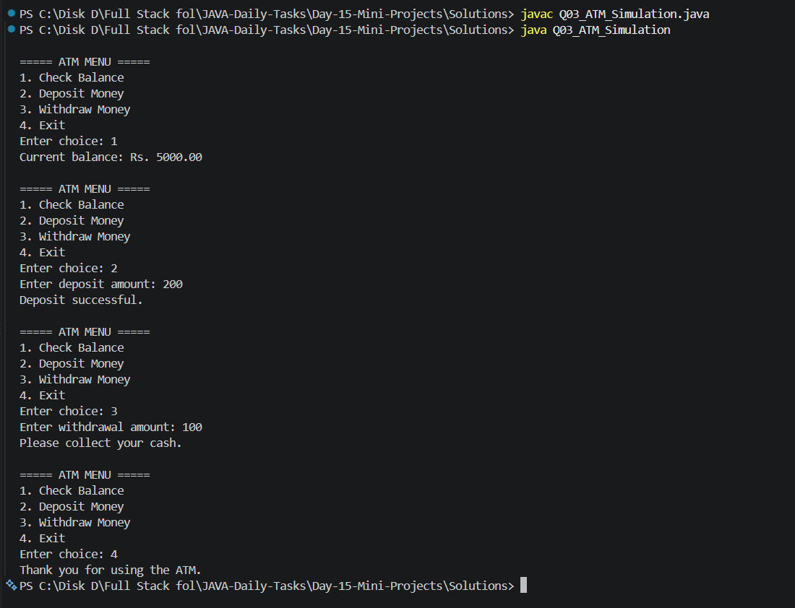
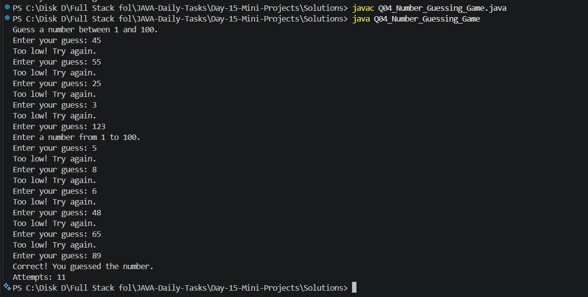
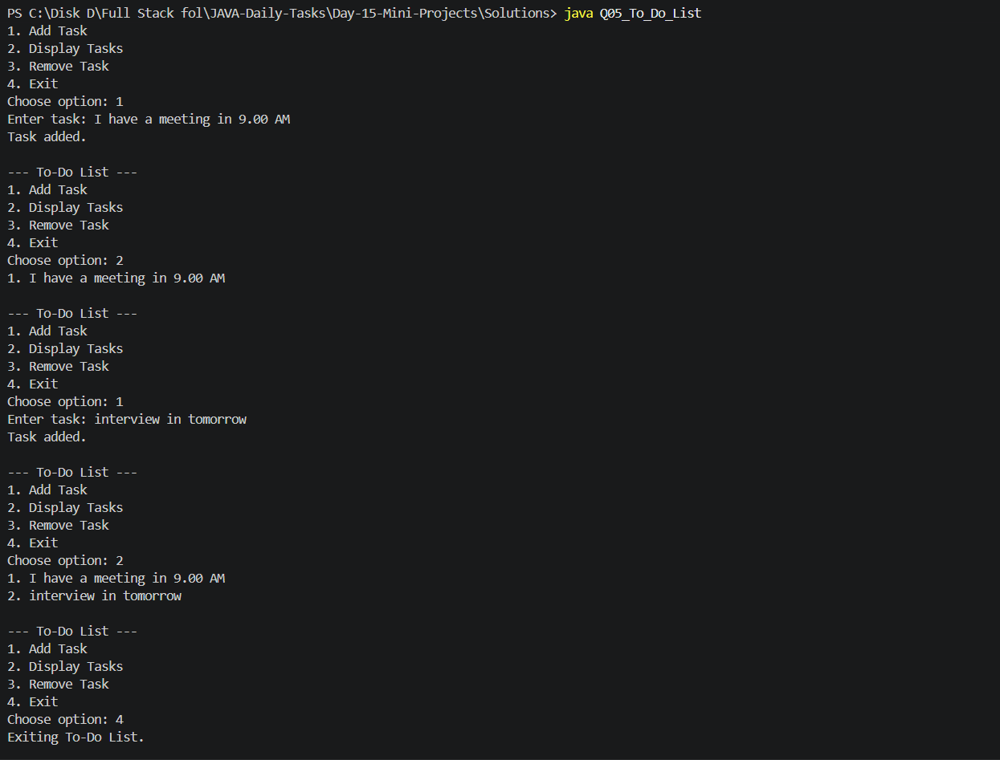

# Day 15 - Mini Projects

## Introduction

Day 15 is the final day of my 15-day Java practice series.

This folder contains five console-based mini projects that combine Java fundamentals, Object-Oriented Programming, collections, loops, conditional statements, and user input.

## Objectives

- Apply Java fundamentals to practical problems
- Practice classes and objects
- Use `ArrayList` to store and manage data
- Build menu-driven console applications
- Handle user input and validate values
- Improve logical thinking and problem-solving skills

## Topics Covered

- Classes and Objects
- ArrayList
- Scanner
- Conditional Statements
- Loops
- Switch Statements
- Methods and Constructors
- Random Number Generation
- Data Validation
- Menu-Driven Applications

## Folder Structure

```text
Day-15-Mini-Projects/
│
├── Questions/
│   └── Questions.txt
│
├── Solutions/
│   ├── Q01_Student_Management_System.java
│   ├── Q02_Bank_Account_Management.java
│   ├── Q03_ATM_Simulation.java
│   ├── Q04_Number_Guessing_Game.java
│   └── Q05_To_Do_List.java
│
├── Screenshots/
│   ├── Output_1.png
│   ├── Output_2.png
│   ├── Output_3.png
│   ├── Output_4.png
│   └── Output_5.png
│
└── README.md
```

## Mini Projects

### Q01 - Student Management System

Add students, display all students, and search for a student using their ID.

**Solution:** `Q01_Student_Management_System.java`





### Q02 - Bank Account Management

Check the balance, deposit money, and withdraw money with balance validation.

**Solution:** `Q02_Bank_Account_Management.java`



### Q03 - ATM Simulation

Use a menu-driven interface to check balance, deposit money, withdraw money, and exit.

**Solution:** `Q03_ATM_Simulation.java`



### Q04 - Number Guessing Game

Guess a randomly generated number between 1 and 100. Receive hints and track the number of attempts.

**Solution:** `Q04_Number_Guessing_Game.java`



### Q05 - To-Do List Application

Add, display, and remove tasks using an `ArrayList`.

**Solution:** `Q05_To_Do_List.java`



## How to Compile and Run

Open PowerShell and navigate to the Solutions folder:

```powershell
cd "C:\Disk D\Full Stack fol\JAVA-Daily-Tasks\Day-15-Mini-Projects\Solutions"
```

Compile all five Java programs:

```powershell
javac *.java
```

Run the programs individually:

```powershell
java Q01_Student_Management_System
java Q02_Bank_Account_Management
java Q03_ATM_Simulation
java Q04_Number_Guessing_Game
java Q05_To_Do_List
```

## Technologies Used

- Java
- VS Code
- PowerShell
- Git
- GitHub

## Learning Outcomes

Through these mini projects, I practiced:

- Combining Java concepts into complete applications
- Managing collections of objects
- Implementing menu-driven programs
- Validating user input
- Using loops and switch statements
- Building simple console-based applications

## Progress

| Day | Topic | Status |
|---|---|---|
| Day 01 | Java Basics | Completed |
| Day 02 | Conditional Statements | Completed |
| Day 03 | Real-World Conditions | Completed |
| Day 04 | Loops | Completed |
| Day 05 | Number Programs | Completed |
| Day 06 | Pattern Programs | Completed |
| Day 07 | Arrays Basics | Completed |
| Day 08 | Arrays Problem Solving | Completed |
| Day 09 | String Basics | Completed |
| Day 10 | Methods | Completed |
| Day 11 | OOP Basics | Completed |
| Day 12 | OOP Advanced | Completed |
| Day 13 | Collections | Completed |
| Day 14 | Exception & File Handling | Completed |
| Day 15 | Mini Projects | Completed |

## Final Status

**15-Day Java Daily Tasks Practice Series Completed!**